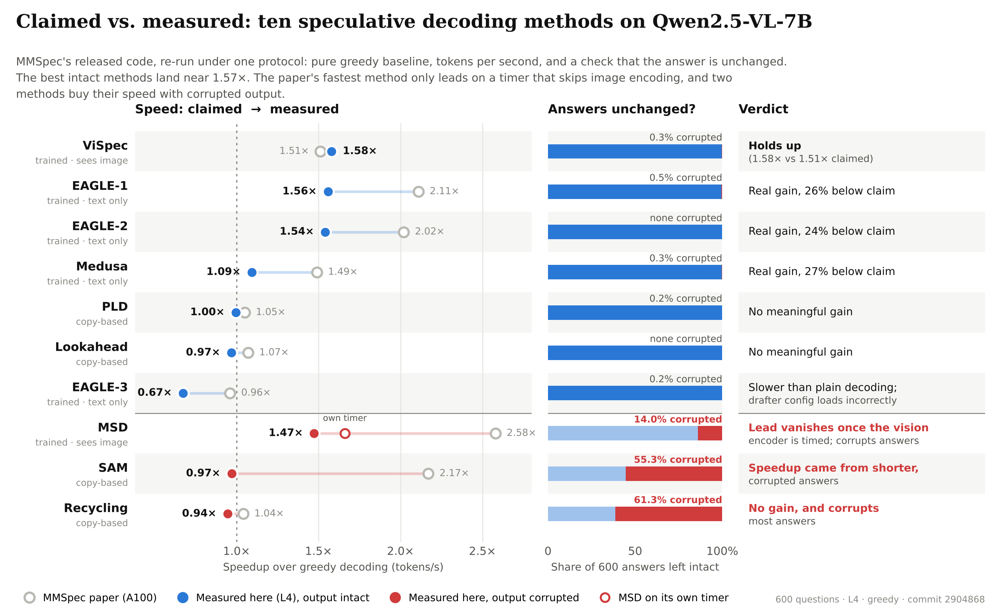

# MMSpec reproduction (Setting A, batch size 1)

Fair re-run of the ten speculative decoding methods in MMSpec ([arXiv:2603.14989](https://arxiv.org/abs/2603.14989)) on **Qwen2.5-VL-7B-Instruct**, on one NVIDIA L4, for the 60-question `testmini` split and the full 600-question `test` split.

MMSpec's own code is not copied here. Clone it at the pinned commit; everything in `tools/` either drives it or writes separate copies of its files, never changing the originals.

## Headline results (600 questions, L4, greedy)

Speedup is pooled tokens/s against a pure greedy baseline, with a 95% bootstrap interval (2,000 resamples of questions). MAT is the mean number of draft tokens accepted per verification step; it does not depend on the GPU, so it is the column to compare with the paper (which used A100s).

| Method | MAT ours / paper | Speedup (95% CI) | Paper | Length vs. base | Corrupted answers | Junk after answer |
|---|---|---|---|---|---|---|
| ViSpec | 2.27 / 1.29 | 1.58 (1.55–1.61) | 1.51 | 1.01 | 0.3% | 8.0% |
| EAGLE-1 | 2.19 / 2.36 | 1.56 (1.52–1.60) | 2.11 | 0.99 | 0.5% | 7.8% |
| EAGLE-2 | 1.70 / 1.78 | 1.54 (1.50–1.58) | 2.02 | 1.00 | 0.0% | 6.2% |
| MSD, own timer | 2.67 / 2.57 | 1.66 (1.62–1.70) | 2.58 | 0.87 | 14.0% | 0.0% |
| MSD, vision encoder timed | | 1.47 (1.43–1.52) | | | | |
| Medusa | 0.77 / 0.80 | 1.09 (1.08–1.11) | 1.49 | 1.00 | 0.3% | 8.7% |
| PLD | 0.16 / 0.17 | 1.00 (0.98–1.01) | 1.05 | 1.02 | 0.2% | 0.2% |
| Lookahead | 0.37 / 0.33 | 0.97 (0.94–1.00) | 1.07 | 1.00 | 0.0% | 0.0% |
| SAM | 0.26 / 0.23 | 0.97 (0.94–1.00) | 2.17 | 0.48 | 55.3% | 0.3% |
| Recycling | 0.11 / 0.11 | 0.94 (0.93–0.95) | 1.04 | 1.01 | 61.3% | 0.0% |
| EAGLE-3 | 0.06 / 0.24 | 0.67 (0.67–0.68) | 0.96 | 0.99 | 0.2% | 0.0% |

Main findings (all about MMSpec's released code at commit `2904868`):

1. **MAT reproduces for 8 of 10 methods**, so the harness measures drafting correctly. ViSpec is higher than MMSpec reports (2.27 vs 1.29) and matches the original ViSpec paper (2.24). EAGLE-3 is lower; its log warns that the drafter config loads as the wrong model type.
2. **SAM, Recycling and MSD are not lossless.** They corrupt 55%, 61% and 14% of answers (doubled words, stray tokens, dropped words). The greedy baseline has none.
3. **MSD's lead comes from its timer.** It starts timing after the vision encoder runs. Charged for that work like every other method, it is significantly slower than EAGLE-1 and ViSpec (paired differences −0.08 and −0.11).
4. **SAM's speedup comes from shorter output.** It writes 0.48× the baseline's tokens: 2.02× faster by the clock, 0.97× per token.
5. **No clear winner among intact methods.** ViSpec and EAGLE-1 cannot be separated; ViSpec beats EAGLE-2 by a small, reliable 0.04.
6. **Protocol issues in the benchmark.** The baseline inherits Qwen's `repetition_penalty=1.05` while the methods decode pure greedy (8% exact agreement), and the batch-size setting only reorders samples.
7. **Minor:** EAGLE-1/2, ViSpec and Medusa append a stray token (`addCriterion`) after a complete answer in 6–9% of cases. This is probably end-of-sequence handling in their shared tree verification, but it is not yet confirmed in code.

The full write-up is `reports/MMSpec_results_L4_600q.pdf`.



## Figures (`reports/figures/`, PNG and PDF)

| File | Shows |
|---|---|
| `fig0_claimed_vs_measured` | One-page summary: claimed vs. measured speed, answer integrity, and a verdict for each method |
| `fig1_paper_vs_ours_speedup` | Paper speedup vs. ours with 95% CIs, including MSD timed fairly |
| `fig2_answer_problems` | Corrupted answers vs. a stray token after a complete answer, per method |
| `fig3_clock_vs_tokens_per_second` | Wall-clock vs. tokens/s speedup: shorter output looks fast on the clock |
| `fig4_msd_timer_by_task` | MSD on its own timer vs. with the vision encoder included, by task |
| `fig5_speedup_by_task` | Speedup heatmap, method × task |
| `fig6_mat_ours_vs_paper` | Acceptance (MAT) ours vs. paper |

## Layout

```
tools/       run and analysis scripts (see below)
gcp/         GCP project, VM and environment setup used for these runs
runs/        raw outputs: one JSONL per method + run_logs/ (env.txt, status.tsv, per-method logs)
  l4_testmini_60/   60 questions, Nov 4–7 2026
  l4_test_600/      600 questions, Nov 9–10 2026
analysis/    script outputs for each run (summaries, quality checks, bootstrap and paired comparisons)
reports/     PDF write-ups and the methods taxonomy figure
```

Folders are named `runs/` and `run_logs/` because the repository's `.gitignore` excludes `results/` and `logs/`.

## Environment

| | |
|---|---|
| MMSpec | commit `290486861eabd746075ca776adb66175636c1fc0` |
| Model | Qwen2.5-VL-7B-Instruct |
| Software | torch 2.7.0+cu126, transformers 4.51.3, accelerate 1.6.0, qwen-vl-utils 0.0.11 |
| Hardware | 1× NVIDIA L4 24 GB, GCP spot VM (`g2-standard-8`, us-east1) |
| Decoding | greedy, temperature 0, batch size 1, MMSpec default image sizes |

The exact environment for each run is in `runs/*/run_logs/env.txt`.

## Reproduce

```bash
# 1. VM: gcp/1_gcp_project_setup.sh, gcp/2_create_vm.sh, then on the VM gcp/3_vm_bootstrap.sh
#    The VM has no external IP; allow SSH through IAP once per project, then connect with --tunnel-through-iap:
gcloud compute firewall-rules create allow-iap-ssh --network=default --direction=INGRESS \
  --action=allow --rules=tcp:22 --source-ranges=35.235.240.0/20
gcloud compute ssh <vm-name> --zone <zone> --tunnel-through-iap

# 2. MMSpec at the pinned commit, with these tools next to it
git clone https://github.com/Senmo996/MMSpec.git MMSpec && cd MMSpec && git checkout 2904868
cp -r /path/to/mmspec_repro/tools ./tools
# Medusa's evaluator expects a local folder, so download the released checkpoint first
huggingface-cli download ping69852/Medusa-Qwen2.5-VL-7B-Instruct --local-dir ~/ckpt/medusa
export MEDUSA_CKPT=~/ckpt/medusa

# 3. Run (baseline_greedy first; finished questions are skipped on rerun)
bash tools/run_mmspec.sh testmini baseline_greedy baseline eagle eagle2 eagle3 vispec msd_e2e medusa pld lookahead recycling sam
bash tools/run_mmspec.sh test     baseline_greedy eagle vispec eagle2 msd_e2e pld sam recycling lookahead eagle3 medusa baseline

# 4. Analyse
D=results/Qwen2.5-VL-7B/mmspec_test
python tools/summarize_mmspec.py $D --baseline baseline_greedy-temperature-0.jsonl --expected 600
python tools/quality_check.py $D
python tools/deep_check.py $D
python tools/analyze_runs.py $D
python tools/make_figures.py $D <summary_vs_greedy.csv> reports/figures
python tools/make_overview_figure.py $D <summary_vs_greedy.csv> reports/figures
```

## Tools

| Script | What it does |
|---|---|
| `run_mmspec.sh` | Runs the listed methods on one GPU, records the environment and exit codes, then summarizes |
| `make_baseline_greedy.py` | Copy of MMSpec's baseline with `repetition_penalty=1.0`, so the reference decodes pure greedy like the methods |
| `make_msd_e2e.py` | Copy of the MSD evaluator that also logs vision-encoder time (`embed_prep_time`) and exact per-turn acceptance |
| `validate_msd_e2e.py` | Checks the MSD copy against the original: same samples, outputs, timing and acceptance |
| `summarize_mmspec.py` | Per-task MAT and speedup against the paper, exact match, and an aggregation table (pooled, mean, median, end-to-end, p50/p95 latency) |
| `quality_check.py` | Counts doubled-word and junk-token answers per method |
| `deep_check.py` | Exact-match matrix, where answers diverge from greedy, analysis of shorter answers, length-cap check |
| `analyze_runs.py` | Separates mid-answer corruption from junk after the answer; bootstrap CIs and paired comparisons |
| `make_figures.py` | Figures 1–6 |
| `make_overview_figure.py` | Figure 0, the one-page summary |

## Notes and known gaps

- **Medusa on testmini** was rerun separately on Nov 8 with the released checkpoint. Its JSONL is not included in `runs/l4_testmini_60/` yet; the 600-question run includes Medusa.
- **MSD on testmini.** `msd_e2e` was produced before a fix to how per-turn acceptance is snapshotted, so its `accept_sum` fields are near zero and `validate_msd_e2e.txt` fails checks 5–6. `summarize_mmspec.py` reconstructs exact per-turn acceptance from the running average instead. The 600-question run uses the fixed version.
- **Scope.** The 600-question run has no plain `msd` file. `msd_e2e` is the same evaluator, and its `wall_time` keeps MSD's original timer boundary.
- All claims concern MMSpec's released implementation, not necessarily the code behind the published figures. L4 speedups are not directly comparable with the paper's A100 numbers.
